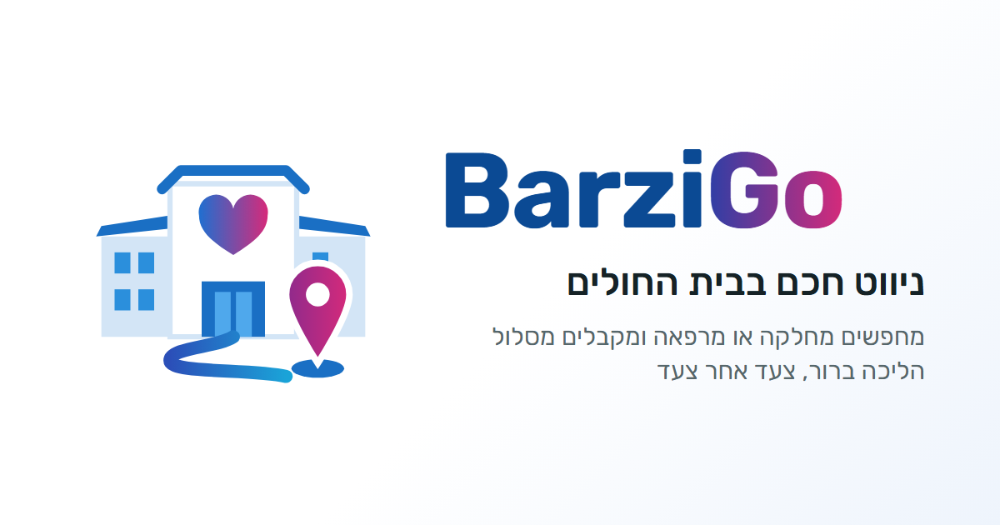

  

# BarziGo – ניווט חכם בבית החולים

BarziGo עוזר למטופלים, למבקרים ולאנשי צוות להגיע למחלקה, למרפאה או לשירות בתוך מתחם גדול, בלי ללכת לאיבוד ובלי לחץ. מחפשים יעד, ומקבלים מסלול הליכה ברור על המפה ומלווה בהוראות צעד אחר צעד.

הפיילוט הראשון מתוכנן במרכז הרפואי ברזילי באשקלון.

> **אב-טיפוס.** זה לא אתר רשמי של בית החולים. המפה משורטטת לפי מפת המתחם הציבורית, והמסלולים משוערים ועדיין לא נבדקו בשטח.

## קישורים

| | |
|---|---|
| 🗺️ **הדמו** | https://nivpro9.github.io/barzigo/ |
| 📱 **דוגמה: הגעה מהודעת SMS של זימון תור** | https://nivpro9.github.io/barzigo/#sms-eye |
| 📋 **כלי המיפוי לאיסוף נתונים מהשטח** (לעורכים בלבד) | https://nivpro9.github.io/barzigo/mapping.html |

## מה אפשר לעשות

- **חיפוש יעד:** לפי שם המחלקה, מילה נרדפת (למשל "עיניים" או "רנטגן") או מספר בניין. במסך הראשי יש גם כפתורים מהירים ליעדים הנפוצים.
- **מסלול על המפה:** כולל זמן הליכה, מרחק והוראות צעד אחר צעד ("פנו ימינה והמשיכו עד…").
- **ניווט בתוך הבניין:** הכניסה, הקומה, המעלית והדרך עד המחלקה, בבניינים שכבר מופו בשטח.
- **ניווט חי:** לפי GPS, אחרי כיול חד-פעמי בשני שערי בית החולים. יש גם הדמיית הליכה לצורך הצגה.
- **מסלול נגיש:** עוקף מדרגות, מעדיף רמפות ומעליות, ומזהיר כשאין דרך נגישה ידועה.
- **4 שפות:** עברית, ערבית, אנגלית ורוסית.
- **נגישות:** טקסט גדול, מצב כהה, והקראה בקול של ההוראות.
- **נקודות QR:** כל מדבקת QR בשטח פותחת את האתר עם נקודת היציאה הנכונה, למשל `#qr-gate1`, `#qr-gate2`, `#qr-p1` עד `#qr-p4` ו-`#qr-here`.

## איך זה בנוי

- **בלי אפליקציה ובלי חומרה:** אתר רגיל שנפתח מסריקת QR או מקישור. אין צורך בהתקנה או במשדרי Bluetooth.
- **קובץ אחד:** כל הדמו נמצא ב-`index.html`, בלי שלב בנייה ובלי ספריות חיצוניות (חוץ מגופנים מ-Google Fonts).
- **מפת המתחם:** בניינים, שבילים ודרכים מצוירים כ-SVG. השבילים בנויים כגרף, והמסלול הקצר ביותר מחושב באלגוריתם Dijkstra.
- **נתונים מהשטח:** נשמרים ב-[Supabase](https://supabase.com). כלי המיפוי כותב אליו, והדמו קורא ממנו בכל טעינה. רק מיילים שברשימת העורכים יכולים לשנות נתונים, וכל השאר יכולים רק לקרוא.
- **אחסון:** GitHub Pages. כל עדכון שנכנס לענף `main` מופיע באתר אחרי כדקה.

## קבצים

| קובץ | מה יש בו |
|---|---|
| `index.html` | הדמו המלא: מפה, חיפוש, מסלולים, ניווט חי ותרגומים |
| `mapping.html` | כלי המיפוי לעורכים: כניסות, קומות, מעליות, מחלקות, מכשולים בשבילים ותמונות |
| `og.png` | התמונה שמופיעה כששולחים את הקישור בוואטסאפ או בפייסבוק |
| `icon.png` | האייקון של האתר |

## אבטחה ופרטיות

- המפה מציגה **רק אזורים ציבוריים**. לא מסומנים בה חדרי שרתים, מחסני תרופות, מסלולי צוות או נקודות אבטחה.
- בכלי המיפוי מצלמים רק אזורים ציבוריים, בלי מטופלים ובלי אזורים של הצוות.
- האתר לא שומר מידע אישי על המבקרים. המיקום מה-GPS ונתוני הכיול נשארים בטלפון של המשתמש ולא נשלחים לשום מקום.

## מצב הפרויקט

- [x] דמו עם מפת המתחם, חיפוש ומסלולים
- [x] ניווט חי (GPS והדמיית הליכה)
- [x] ניווט בתוך הבניין ומסלול נגיש (מחכים לנתונים מהשטח)
- [x] כלי מיפוי עם כניסה במייל
- [ ] חיבור כלי המיפוי ל-Supabase
- [ ] מיפוי הבניינים בשטח
- [ ] כיול ובדיקת GPS בשטח
- [ ] פיילוט עם מחלקת החדשנות של ברזילי

## הצוות

**ניב ממן** ו**סאן כהן**, במסגרת מיזם המעבדות בתואר שיווק טכנולוגי במכללת ספיר.

© 2026 ניב ממן וסאן כהן. כל הזכויות שמורות.

